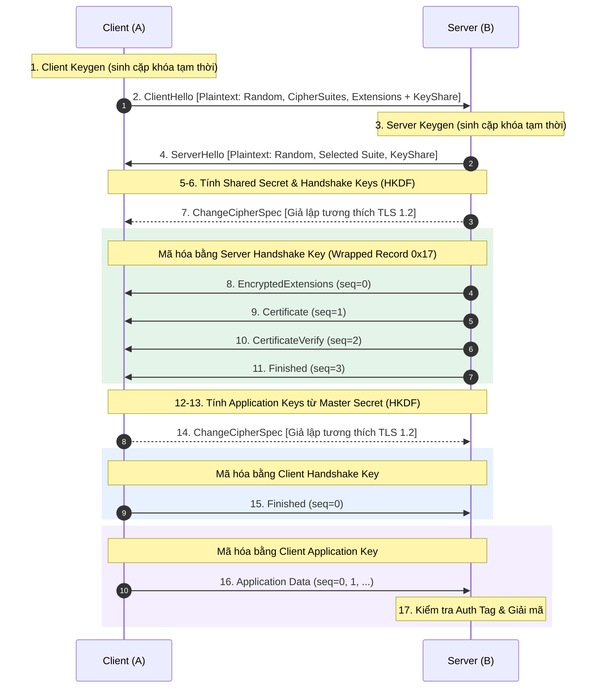

# Báo cáo: Giải thích chi tiết các thành phần trong từng bước của TLS 1.3

Tài liệu này phân tích cấu trúc và vai trò của từng thành phần dữ liệu, khóa mật mã và thông điệp trong quá trình thiết lập kết nối và truyền dữ liệu **TLS 1.3** (theo chuẩn **RFC 8446** và đối chiếu trực tiếp với mô hình từng bước trong `ssl_tls_lab/model_tls13.py`).

---

## 1. Tổng quan luồng hoạt động TLS 1.3

So với TLS 1.2, TLS 1.3 rút gọn quá trình bắt tay (handshake) xuống còn **1-RTT** (một vòng khứ hồi mạng trước khi client có thể gửi dữ liệu ứng dụng), tách biệt hoàn toàn **Cipher Suite** (chỉ còn thuật toán AEAD + Hash) khỏi thuật toán trao đổi khóa và chữ ký số, đồng thời mã hóa toàn bộ phần handshake sau `ServerHello`.

---

## 2. Cấu trúc chung của tầng Record (Record Layer)

Mọi thông điệp TLS đều được đóng gói trong các **TLS Record** trước khi đưa xuống tầng TCP.

### 2.1. Record dạng rõ (TLSPlaintext)
Dùng cho `ClientHello`, `ServerHello` và `ChangeCipherSpec`:
- **ContentType (1 byte):** Loại dữ liệu bên trong (`0x16` = Handshake, `0x14` = ChangeCipherSpec, `0x17` = Application Data, `0x15` = Alert).
- **LegacyRecordVersion (2 byte):** Luôn đặt là `0x0301` (TLS 1.0) ở `ClientHello` đầu tiên hoặc `0x0303` (TLS 1.2) ở các record khác để tránh bị thiết bị mạng cũ (middlebox) chặn. Phiên bản thật `0x0304` (TLS 1.3) nằm trong extension `supported_versions`.
- **Length (2 byte):** Độ dài phần payload tính theo byte (tối đa $2^{14} = 16\,384$ byte cho plaintext).
- **Fragment:** Nội dung thông điệp handshake hoặc CCS.

### 2.2. Record đã bọc (TLSCiphertext / Wrapped Record)
Từ `EncryptedExtensions` trở đi, mọi thông điệp đều được mã hóa xác thực (**AEAD** — ví dụ `AES-128-GCM` hoặc `AES-256-GCM`) và ngụy trang giống một record dữ liệu ứng dụng của TLS 1.2:
- **Header 5 byte (ngoài vỏ):** `17 03 03` (`application_data`, TLS 1.2) + `Length (2 byte)`. Header này **không bị mã hóa** nhưng được dùng làm **AAD (Additional Authenticated Data)** khi tính Auth Tag, giúp chống sửa đổi header trên đường truyền.
- **Inner Plaintext (trước khi mã hóa):** Gồm `Nội dung thật || ContentType thật (1 byte)` (ví dụ `0x16` cho handshake, `0x17` cho application data) + phần đệm tùy chọn. Sau khi giải mã, bên nhận đọc byte cuối cùng này để biết bản chất thông điệp.
- **Ciphertext:** Phần Inner Plaintext đã được mã hóa.
- **Authentication Tag (16 byte):** Mã xác thực GCM nằm ở cuối record.
- **Cách tính Nonce (12 byte):**
  $$\text{Nonce} = \text{IV} \oplus \text{sequence\_number}$$
  Trong đó `IV` dài 12 byte và `sequence_number` là số thứ tự record 64-bit (đệm thêm 4 byte `0x00` ở đầu thành 12 byte), bắt đầu từ `0` và tăng dần cho mỗi record cùng một khóa. Nếu đổi khóa (từ Handshake Key sang Application Key), bộ đếm `sequence_number` reset về `0`.

---

## 3. Phân tích các thành phần trong từng bước

### Bước 0: Chuẩn bị khóa và chứng chỉ (Prepare)
Trước khi kết nối diễn ra, hạ tầng PKI và phía Server (B) cần có:
- **Khóa riêng và Chứng chỉ CA (Root CA):** Dùng để ký phát hành chứng chỉ cho B; Client (A) lưu chứng chỉ CA trong kho tin cậy (Trust Store) để xác minh danh tính B.
- **Khóa riêng chứng chỉ của B (Server Identity Private Key):** RSA (2048/3072 bit) hoặc ECDSA (P-256). Khóa này **không bao giờ** rời khỏi B và chỉ dùng để ký xác thực trong `CertificateVerify` (khác hoàn toàn với khóa trao đổi tạm thời).
- **Chứng chỉ X.509 của B:** Gắn tên miền (SAN / Hostname) và khóa công khai dài hạn của B, có chữ ký của CA.

---

### Bước 1: Client Key Exchange Generation (`client_keygen`)
- **Nhóm trao đổi khóa (Key Exchange Group):** Nhóm toán học dùng để thỏa thuận khóa, phổ biến là `ECDHE X25519` (`0x001d`), `ECDHE P-256` (`0x0017`) hoặc `DHE ffdhe2048` (`0x0100`).
- **Khóa riêng tạm thời của A (Ephemeral Private Key):** Số ngẫu nhiên bí mật chỉ tồn tại cho phiên hiện tại. Nhờ tính tạm thời này, TLS 1.3 đạt được tính chất **Perfect Forward Secrecy (PFS)** — ngay cả khi khóa chứng chỉ của B bị lộ trong tương lai, kẻ tấn công vẫn không thể giải mã dữ liệu đã ghi âm trước đó.
- **Khóa công khai tạm thời của A (Ephemeral Public Key):** Được tính từ khóa riêng tạm thời và tham số nhóm, sẽ gửi công khai trong `ClientHello`.

---

### Bước 2: Client Hello (`client_hello`, A → B)
A khởi tạo phiên và gửi thông điệp Handshake loại `0x01` gồm các thành phần:
- **Legacy Version (`0x0303`):** Trường phiên bản cũ giữ nguyên giá trị TLS 1.2 để tương thích ngược.
- **Client Random (32 byte):** Chuỗi ngẫu nhiên mật mã do A tạo ra để đảm bảo tính tươi mới (freshness), chống tấn công phát lại (replay attack).
- **Legacy Session ID (32 byte):** Trong TLS 1.3 không còn dùng Session ID để nối lại phiên, nhưng A tạo 32 byte ngẫu nhiên giả lập để phục vụ *middlebox compatibility mode*.
- **Cipher Suites:** Danh sách các bộ mã AEAD + Hash mà A hỗ trợ, ví dụ `TLS_AES_128_GCM_SHA256` (`0x1301`) và `TLS_AES_256_GCM_SHA384` (`0x1302`). Lưu ý cipher suite trong TLS 1.3 không còn quy định thuật toán trao đổi khóa hay chữ ký.
- **Legacy Compression Methods (`0x01 0x00`):** Chỉ hỗ trợ `null` (không nén) nhằm tránh các lỗ hổng nén như CRIME/BREACH.
- **Extensions (Phần mở rộng):**
  - `server_name` (`0x0000` - SNI): Tên miền B mà A muốn kết nối.
  - `supported_groups` (`0x000a`): Danh sách các nhóm DH/ECDH mà A hỗ trợ.
  - `signature_algorithms` (`0x000d`): Các thuật toán chữ ký A chấp nhận (ví dụ `ecdsa_secp256r1_sha256`, `rsa_pss_rsae_sha256`, `rsa_pkcs1_sha256`).
  - `supported_versions` (`0x002b`): Chỉ rõ phiên bản thực sự mong muốn là **TLS 1.3 (`0x0304`)**.
  - `key_share` (`0x0033`): Đính kèm luôn khóa công khai tạm thời của A ngay ở gói tin đầu tiên (giúp tiết kiệm 1 RTT so với TLS 1.2).

---

### Bước 3: Server Key Exchange Generation (`server_keygen`)
- B kiểm tra extension `key_share` từ `ClientHello`, chọn nhóm phù hợp (nếu A đã gửi đúng nhóm B hỗ trợ) và sinh cặp **khóa riêng / khóa công khai tạm thời** của riêng B trên cùng nhóm đó.

---

### Bước 4: Server Hello (`server_hello`, B → A)
B phản hồi bằng thông điệp Handshake loại `0x02`. Đây là **record cuối cùng được gửi ở dạng rõ**:
- **Legacy Version (`0x0303`):** Giữ nguyên giá trị TLS 1.2.
- **Server Random (32 byte):** Chuỗi ngẫu nhiên 32 byte do B tạo. (Chuẩn RFC 8446 cũng quy định các giá trị đặc biệt ở 8 byte cuối nếu server hạ cấp xuống TLS 1.2/1.1 để chống downgrade attack).
- **Legacy Session ID Echo:** B lặp lại đúng `Session ID` 32 byte mà A đã gửi.
- **Selected Cipher Suite:** Một cipher suite duy nhất B chọn từ danh sách của A (ví dụ `0x1301`).
- **Extensions:**
  - `supported_versions` (`0x002b`): Xác nhận chọn `0x0304` (TLS 1.3).
  - `key_share` (`0x0033`): Gửi **khóa công khai tạm thời của B** cho A.

---

### Bước 5 & 6: Tính toán Khóa Handshake (`server_hs_keys`, `client_hs_keys`)
Cả B và A thực hiện độc lập phép toán giống hệt nhau:
1. **Tính `shared_secret`:** Mỗi bên kết hợp khóa riêng tạm thời của mình với khóa công khai tạm thời của đối phương (ECDH/DH). Hai bên thu được cùng một `shared_secret`.
2. **Tính `hello_hash`:**
   $$\text{hello\_hash} = H(\text{ClientHello} \parallel \text{ServerHello})$$
   *(Chỉ băm nội dung thông điệp handshake, **không** bao gồm 5 byte record header).*
3. **Dẫn xuất khóa bằng HKDF (HMAC-based Key Derivation Function):**
   - `HKDF-Extract(salt, ikm)`: Trộn muối (`salt`) và vật liệu khóa đầu vào (`ikm`) để tạo khóa giả ngẫu nhiên cố định kích thước hash $hl$ (32 byte với SHA-256, 48 byte với SHA-384).
   - `HKDF-Expand-Label(secret, label, ctx, len)`: Mở rộng bí mật thành khóa/IV theo ngữ cảnh `label` (có tiền tố `"tls13 "`) và hash ngữ cảnh `ctx`.

   Chuỗi dẫn xuất cụ thể:
   - `early_secret = HKDF-Extract(salt: 00...0, key: 00...0)` *(do không dùng PSK/0-RTT)*
   - `derived_secret = HKDF-Expand-Label(early_secret, "derived", H(""), hl)`
   - `handshake_secret = HKDF-Extract(salt: derived_secret, key: shared_secret)`
   - `client_hs_traffic_secret = HKDF-Expand-Label(handshake_secret, "c hs traffic", hello_hash, hl)`
   - `server_hs_traffic_secret = HKDF-Expand-Label(handshake_secret, "s hs traffic", hello_hash, hl)`
   - Từ hai traffic secret trên, tách ra khóa mã hóa (`label: "key"`, dài `kl` = 16 hoặc 32 byte) và vector khởi tạo (`label: "iv"`, dài 12 byte) cho cả chiều Client và Server.

---

### Bước 7: Server Change Cipher Spec (`server_ccs`, B → A)
- Record loại `0x14` với nội dung đúng 1 byte `0x01`.
- Trong TLS 1.3, thông điệp này **không có tác dụng chuyển đổi trạng thái mã hóa** (khóa handshake đã được kích hoạt ngay sau `ServerHello`). Nó chỉ được gửi trong *middlebox compatibility mode* để các thiết bị tường lửa/proxy cũ tưởng đây là một phiên TLS 1.2 bình thường.

---

### Bước 8: Server Encrypted Extensions (`server_ee`, B → A)
- Thông điệp đầu tiên được **mã hóa** bằng `server_handshake_key` và `server_handshake_iv` với `sequence = 0`.
- Handshake type `0x08`. Chứa các extension không cần thiết cho việc chọn khóa ở `ServerHello` (ví dụ: ALPN, SNI ack, max_fragment_length; trong cấu hình tối giản thì danh sách này rỗng).
- Bọc trong Wrapped Record (`17 03 03`) với inner content type cuối bản rõ là `0x16` (handshake).

---

### Bước 9: Server Certificate (`server_cert`, B → A)
- Mã hóa bằng `server_handshake_key` với `sequence = 1`. Handshake type `0x0b` (11).
- Gồm `certificate_request_context` (rỗng vì B không yêu cầu chứng chỉ client) và chuỗi chứng chỉ X.509 dạng DER của B.
- **A thực hiện xác minh:** Kiểm tra chữ ký của CA tin cậy trên chứng chỉ, đối chiếu tên miền (`HOSTNAME`) trong SAN/Subject, và kiểm tra thời hạn hiệu lực.

---

### Bước 10: Server Certificate Verify (`server_cert_verify`, B → A)
- Mã hóa bằng `server_handshake_key` với `sequence = 2`. Handshake type `0x0f` (15).
- **Mục đích:** Chứng minh B thực sự sở hữu **khóa riêng của chứng chỉ** vừa gửi ở Bước 9, ràng buộc danh tính dài hạn của B với khóa trao đổi tạm thời (chống tấn công giả mạo chứng chỉ).
- **Thành phần:**
  - `SignatureScheme` (2 byte): Ví dụ `0x0804` (`rsa_pss_rsae_sha256`) hoặc `0x0403` (`ecdsa_secp256r1_sha256`). Lưu ý TLS 1.3 bắt buộc dùng RSA-PSS thay cho RSA PKCS#1 v1.5 cũ trong handshake.
  - `Signature`: Chữ ký số tạo bởi khóa riêng chứng chỉ của B trên chuỗi dữ liệu chuẩn hóa:
    $$\text{Signing Input} = \underbrace{\text{0x20} \times 64}_{\text{64 byte khoảng trắng}} \parallel \text{"TLS 1.3, server CertificateVerify"} \parallel \text{0x00} \parallel H(\text{ClientHello} \dots \text{Certificate})$$
    *(Chuỗi 64 byte `0x20` và nhãn ngữ cảnh giúp chống tấn công ký chéo giao thức / cross-protocol signature attack).*

---

### Bước 11: Server Handshake Finished (`server_finished`, B → A)
- Mã hóa bằng `server_handshake_key` với `sequence = 3`. Handshake type `0x14` (20).
- **Mục đích:** Xác nhận toàn vẹn toàn bộ lịch sử handshake từ đầu đến giờ không bị ai chỉnh sửa (chống downgrade attack và MITM) và xác nhận hai bên giữ cùng bộ khóa.
- **Công thức tính `verify_data`:**
  - `finished_key = HKDF-Expand-Label(server_hs_traffic_secret, "finished", "", hl)`
  - `finished_hash = H(ClientHello ... CertificateVerify)`
  - `verify_data = HMAC-H(finished_key, finished_hash)`
- A tự tính lại `verify_data` kỳ vọng và so sánh theo thời gian hằng (`hmac.compare_digest`). Nếu sai lệch, kết nối bị hủy ngay lập tức.

---

### Bước 12 & 13: Tính toán Khóa Ứng dụng (`server_app_keys`, `client_app_keys`)
Ngay sau khi `ServerFinished` hoàn tất, cả B và A dẫn xuất bộ khóa dùng cho dữ liệu ứng dụng thực tế:
1. **Tính `handshake_hash`:**
   $$\text{handshake\_hash} = H(\text{ClientHello} \dots \text{ServerFinished})$$
   *(Bỏ qua 5 byte header của các record và byte content type `0x16` ở cuối bản rõ đã bọc).*
2. **Dẫn xuất Master Secret & Application Traffic Keys:**
   - `derived_secret = HKDF-Expand-Label(handshake_secret, "derived", H(""), hl)`
   - `master_secret = HKDF-Extract(salt: derived_secret, key: 00...0)`
   - `client_ap_traffic_secret = HKDF-Expand-Label(master_secret, "c ap traffic", handshake_hash, hl)`
   - `server_ap_traffic_secret = HKDF-Expand-Label(master_secret, "s ap traffic", handshake_hash, hl)`
   - Tách thành `client_application_key`, `client_application_iv`, `server_application_key`, `server_application_iv`.

---

### Bước 14: Client Change Cipher Spec (`client_ccs`, A → B)
- Tương tự Bước 7: record `0x14` chứa `0x01` nhằm mục đích tương thích với middlebox cũ.

---

### Bước 15: Client Handshake Finished (`client_finished`, A → B)
- Thông điệp handshake cuối cùng của A (Handshake type `0x14`), mã hóa bằng **`client_handshake_key` và `client_handshake_iv`** với **`sequence = 0`** (vì đây là record mã hóa đầu tiên theo chiều A → B).
- `verify_data` được tính bằng `HMAC` với `finished_key` dẫn xuất từ `client_hs_traffic_secret` trên `H(ClientHello ... ServerFinished)`.
- B giải mã, tự tính lại `verify_data` và đối chiếu. Khi khớp, quá trình handshake chính thức thành công.

---

### Bước 16: Client Application Data (`client_app_data`, A → B)
- Dữ liệu ứng dụng (bản rõ UTF-8) được chia thành các phân mảnh tối đa `16 384` byte (`MAX_FRAGMENT`).
- Mỗi phân mảnh được gắn byte cuối `0x17` (inner content type = `application_data`), sau đó mã hóa bằng **`client_application_key`** và **`client_application_iv`** với bộ đếm `sequence` tăng dần từ `0` (`0, 1, 2, ...`).
- Đầu ra là Wrapped Record gồm: `5-byte header (17 03 03 + len)` + `Ciphertext` + `16-byte Auth Tag`.

---

### Bước 17: Server Xác thực Tag và Giải mã (`server_decrypt`, ở B)
- B nhận record, đọc 5 byte header làm `AAD`, tính `Nonce = client_application_iv XOR sequence_number`.
- Đưa `client_application_key`, `Nonce`, `AAD`, `Ciphertext`, và `Auth Tag` vào hàm giải mã **AES-GCM**:
  - **Nếu Auth Tag hợp lệ:** Giải mã thành công Inner Plaintext, kiểm tra và tách bỏ byte loại record ở cuối (`0x17`), thu được bản rõ thông điệp ban đầu.
  - **Nếu bị sửa đổi dù chỉ 1 bit** (ở header, ciphertext hoặc tag): AES-GCM phát hiện tag không khớp (`InvalidTag`), B **hủy toàn bộ record**, không trả về bất kỳ byte bản rõ nào và phát cảnh báo lỗi `bad_record_mac`.

---

## 4. Bảng tóm tắt các thành phần mật mã quan trọng

| Thành phần | Nơi tạo / tính | Có gửi qua mạng? | Vai trò chính |
| :--- | :--- | :--- | :--- |
| **Client/Server Random** | A và B (32 byte mỗi bên) | Có (dạng rõ trong Hello) | Chống replay attack, đảm bảo tính duy nhất của phiên |
| **Khóa riêng tạm thời (Ephemeral Priv)** | A và B tự sinh | **Không** | Kết hợp với khóa công khai đối phương để tạo `shared_secret` (đảm bảo PFS) |
| **Khóa công khai tạm thời (Key Share)** | A và B | Có (dạng rõ trong Hello) | Chia sẻ tham số DH/ECDH để hai bên tính chung `shared_secret` |
| **Khóa riêng chứng chỉ (Identity Priv)** | B | **Không** | Ký `CertificateVerify` để chứng minh danh tính chủ sở hữu chứng chỉ |
| **Shared Secret** | A và B tự tính | **Không** | Bí mật chung thô đầu vào cho chuỗi HKDF |
| **Handshake Secret & Traffic Keys** | A và B tự dẫn xuất | **Không** | Mã hóa & xác thực toàn bộ phần handshake sau `ServerHello` |
| **Master Secret & App Traffic Keys** | A và B tự dẫn xuất | **Không** | Mã hóa & xác thực dữ liệu ứng dụng (`Application Data`) |
| **IV & Sequence Number** | A và B | **Không** | XOR với nhau tạo `Nonce` duy nhất cho từng record AES-GCM |
| **AAD (5-byte Record Header)** | Bên gửi tạo, bên nhận đọc | Có (dạng rõ đầu record) | Bảo vệ toàn vẹn phần vỏ record (độ dài, phiên bản) qua Auth Tag |
| **Auth Tag (16 byte)** | Bên gửi tính, bên nhận kiểm tra | Có (cuối Wrapped Record) | Đảm bảo tính toàn vẹn và xác thực của toàn bộ bản mã + AAD |

